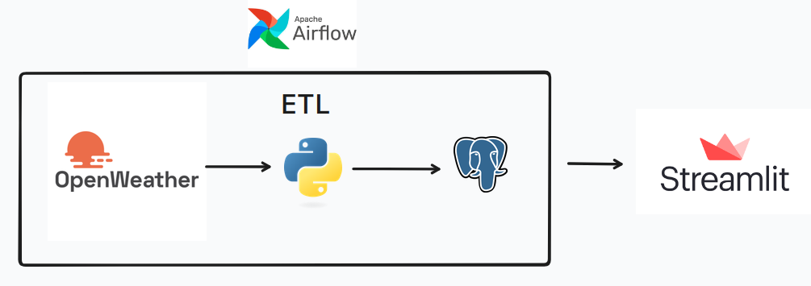
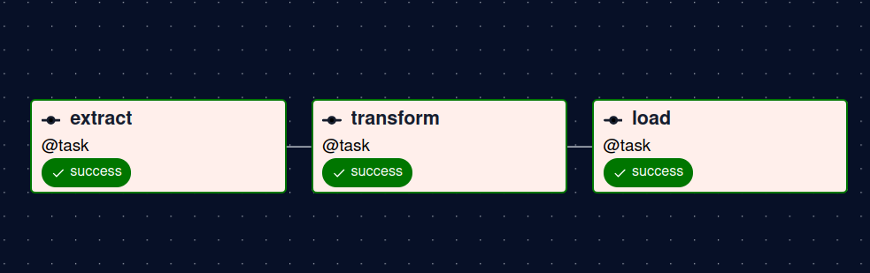
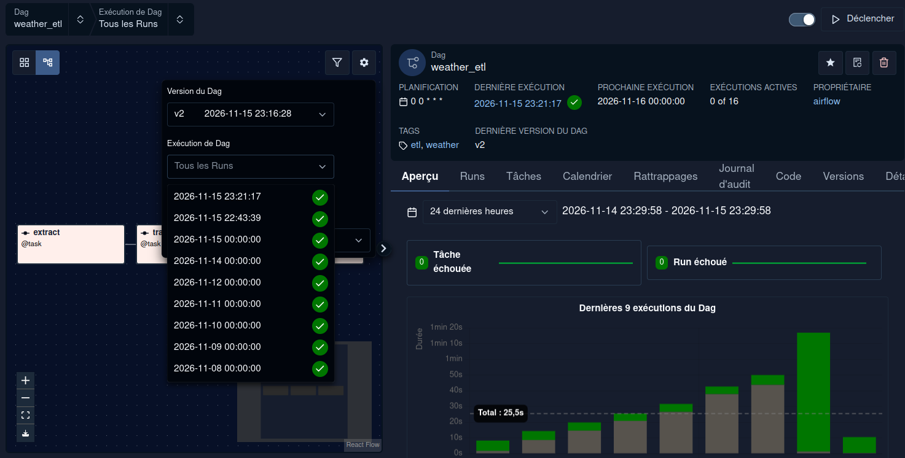
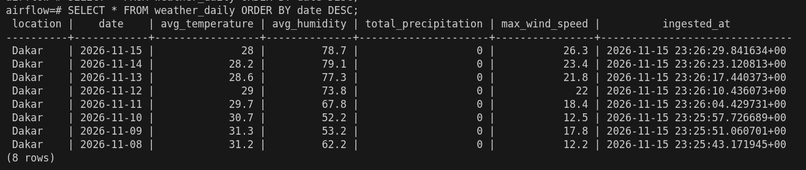
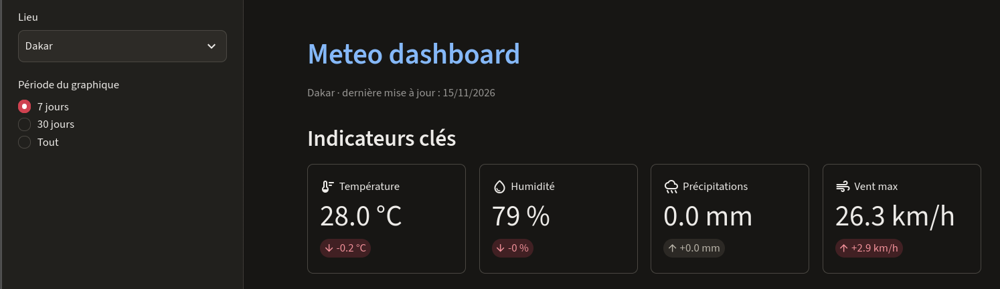
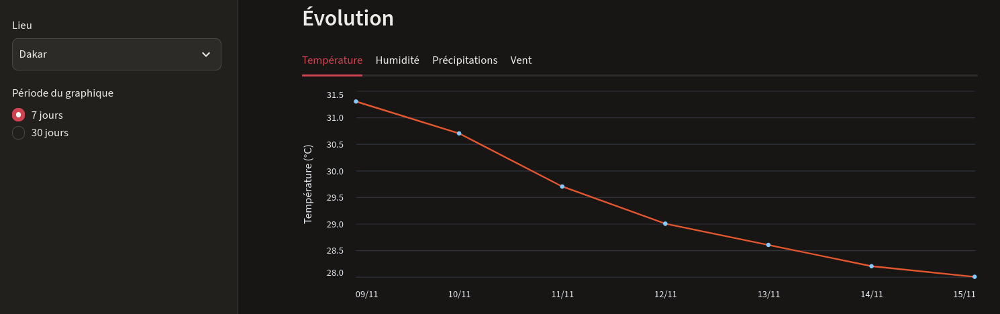

# Weather Data Pipeline with Apache Airflow

A daily ETL pipeline that extracts weather data for **Dakar, Senegal** from the [Open-Meteo API](https://open-meteo.com/), transforms it into a daily summary, and loads it into **PostgreSQL**. The pipeline is orchestrated with **Apache Airflow 3** and runs in **Docker**.

## Architecture



*Diagram made with [tldraw](https://www.tldraw.com/).*

| Step | Description |
|---|---|
| **Extract** | Calls the Open-Meteo forecast API and returns 24 hourly values per variable. |
| **Transform** | Cleans missing values and aggregates the hourly data into one daily row. |
| **Load** | Upserts the daily row into the `weather_daily` table in PostgreSQL. |

## Tech stack

- Python 3.13
- Apache Airflow 3 (TaskFlow API)
- PostgreSQL
- Docker and Docker Compose
- Open-Meteo API (free, no API key required)


## Data collected

Hourly variables requested for Dakar (`14.6937, -17.4441`, timezone `Africa/Dakar`):

| Variable | Daily output |
|---|---|
| `temperature_2m` | `avg_temperature` |
| `relative_humidity_2m` | `avg_humidity` |
| `precipitation` | `total_precipitation` |
| `wind_speed_10m` | `max_wind_speed` |

## Database schema

```sql
CREATE TABLE IF NOT EXISTS weather_daily (
    location            TEXT NOT NULL,
    date                DATE NOT NULL,
    avg_temperature     REAL,
    avg_humidity        REAL,
    total_precipitation REAL,
    max_wind_speed      REAL,
    ingested_at         TIMESTAMPTZ DEFAULT now(),
    PRIMARY KEY (location, date)
);
```

The load step uses `INSERT ... ON CONFLICT DO UPDATE`, so re-running the DAG on the same day updates the row instead of creating a duplicate.

## Getting started

### 1. Clone the repository

```bash
git clone https://github.com/abdoulayedabo/weather-data-pipeline-airflow.git
cd weather-data-pipeline-airflow
```

### 2. Configure environment variables

```bash
cp .env.example .env
```

Example `.env`:

```bash
POSTGRES_USER=airflow
POSTGRES_PASSWORD=airflow
POSTGRES_DB=airflow
POSTGRES_HOST=postgres
POSTGRES_PORT=5432

AIRFLOW_UID=50000
AIRFLOW_API_SECRET_KEY=change-me-secret
AIRFLOW_JWT_SECRET=change-me-jwt-secret
```

### 3. Start the services

```bash
docker compose up -d
```


### 4. Run the DAG

1. Open the Airflow UI at [http://localhost:8080](http://localhost:8080).
2. Enable the `weather_etl` DAG.
3. Trigger it manually, or wait for the daily schedule.

## DAG overview

- **DAG id:** `weather_etl`
- **Schedule:** `@daily`
- **Retries:** 2
- **Catchup:** enabled





## Verify the results

```bash
docker compose exec postgres psql -U airflow -d airflow -c "SELECT * FROM weather_daily ORDER BY date DESC;"
```




## Dashboard

A [Streamlit](https://streamlit.io/) dashboard reads the `weather_daily` table and displays the key metrics (temperature, humidity, precipitation, max wind) with day-over-day changes, plus one chart per variable.

- Location selector (the table supports several locations)
- Chart period selector: 7 days, 30 days, or all available history
- Raw data table



*Key metrics: latest temperature, humidity, precipitation and max wind speed, with the change since the previous day.*



*Trend chart: one tab per variable (temperature, humidity, precipitation, wind), with a selectable period.*


### Run the dashboard

The dashboard is started with the rest of the stack by `docker compose up -d`.

Open the Streamlit dashboard at [http://localhost:8501](http://localhost:8501).

## Possible improvements

- Store hourly data in a separate table
- Add data quality checks and alerts
- Add unit tests for `transform`